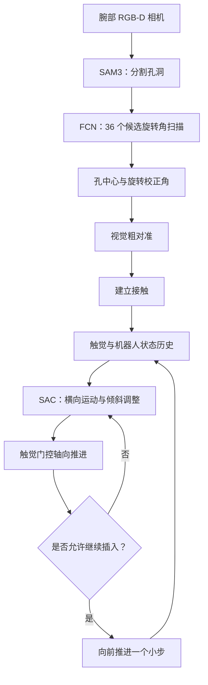

# Beyond Clearance: Learning Contact Negotiation for Soft Peg-in-Hole Assembly

本仓库包含软质插销入孔装配系统的两个核心模块：

1. **基于视觉的粗对准：** 使用 ResNet-18 FCN 预测孔中心热力图，并通过 36 个候选旋转角度扫描，估计孔中心及平面内旋转校正角。
2. **接触协商：** 使用 Soft Actor-Critic（SAC）策略控制真实 UR5 机器人的横向运动和倾斜，并根据触觉反馈决定是否执行小步轴向插入。

> **重要实现说明：** 当前代码中的 FCN 和 SAC 是相互独立的模块。现有 SAC 环境不会直接调用 FCN。完整的 SAM3 → FCN → 深度/位姿恢复 → 机器人视觉粗对准流程，尚未集成到当前代码中。

---

## 1. 系统概览



预期工作流程如下：

- **粗对准：** 分割孔洞，估计孔中心和平面内旋转方向，将插销移动到孔洞上方。
- **接触协商：** 根据触觉反馈和机器人状态，调整横向位置与倾斜角度。只有在力条件允许时，才沿插入轴方向推进。


---

## 2. 仓库结构

```text
project/
├── generate.py                  # 在 PyBullet 中生成合成孔洞图像
├── dataset.py                   # 数据集与中心热力图标签
├── resnet.py                    # ResNet 主干网络
├── models.py                    # ResNet-18 FCN
├── rotation_equivariant.py      # 36 角度旋转扫描与结果解码
├── losses.py                    # 热力图 Focal Loss
├── train.py                     # FCN 训练与评估
├── test.py                      # 单张图像 FCN 推理
│
├── rl_env.py                  # 真实机器人 Gymnasium 环境
├── rl_train.py                # SAC 训练与评估
│
├── data/
│   ├── images/
│   └── manifest.jsonl
├── rl_reset_pose_left.json      # 机器人复位位姿
└── rl_task_frame_left.json      # 任务坐标系
```

真实机器人环境还依赖以下项目专用模块，这些模块必须能够在 Python 路径中被找到：

- `A_ur5_tilt.py`：UR5 连接与运动控制。
- `A_tactile_sensor0.py`：触觉传感器通信。
- `black_ratio.py`：相机 ROI 与黑色区域处理。

---

## 3. FCN 视觉模块

### 网络结构

FCN 输入为**单通道灰度图像或二值图像**，输出为单通道孔中心热力图。

```text
输入图像 [B, 1, H, W]
        ↓
ResNet-18 主干网络（GroupNorm）
        ↓
1×1 Conv：512 → 128 + ReLU
        ↓
上采样 ×2
        ↓
1×1 Conv：128 → 32 + ReLU
        ↓
上采样 ×2
        ↓
1×1 Conv：32 → 1
        ↓
孔中心热力图 logits
```

当前 FCN 使用随机初始化的 ResNet-18 主干网络，不会自动加载 ImageNet 预训练权重。

### 旋转角度扫描

`rotation_equivariant.py` 会评估 36 个候选旋转角度：

$$
0^\circ,\ 10^\circ,\ 20^\circ,\ \ldots,\ 350^\circ
$$

对于每个候选角度，程序会旋转输入图像，调用共享的 FCN，并使用输出热力图经过 sigmoid 后的最大响应值进行评分。程序选择得分最高的分支，将对应热力图反向旋转回原始图像坐标系，再通过热力图峰值确定孔中心位置。

解码结果包括：

- `center`：预测的图像像素坐标系下的孔中心；
- `rotation_deg`：选中的扫描角度；
- `correction_deg`：带符号的平面内旋转校正角；
- `center_score`：热力图峰值置信度。

### 合成数据集

`generate.py` 使用 PyBullet 生成四种孔形状的二值图像：

- 圆形
- 正方形
- 六边形
- 直角三角形

默认设置为：图像分辨率 640×480，每种形状生成 1,000 个样本，训练集/验证集/测试集按照 70/15/15 的比例划分。

`manifest.jsonl` 保存图像路径、中心点标签、位姿、形状、数据集划分，以及考虑形状旋转对称性后的有效角度类别。

`dataset.py` 负责读取图像并生成高斯分布形式的孔中心热力图，同时返回一个长度为 36 的有效角度掩码，用于处理旋转对称性。

### 训练 FCN

安装主要依赖：

```bash
pip install numpy pillow pybullet trimesh matplotlib
pip install torch torchvision
```

生成数据集：

```bash
python generate.py --output-dir data --samples-per-shape 1000 --seed 42
```

训练：

```bash
python train.py \
  --data-dir data \
  --epochs 100 \
  --batch-size 4 \
  --learning-rate 1e-4 \
  --downsample-factor 2 \
  --canvas-size 400 \
  --scan-chunk-size 2
```

如果当前环境不支持 `torch.compile`，可以关闭该功能：

```bash
python train.py --no-compile
```

训练脚本会保存：

- `best_heatmap_all_angles_v4.pth`：验证集表现最好的模型检查点；
- `last_heatmap_all_angles_v4.pth`：最近一次训练的模型检查点。

继续训练：

```bash
python train.py --resume \
  --data-dir data \
  --checkpoint best_heatmap_all_angles_v4.pth \
  --last-checkpoint last_heatmap_all_angles_v4.pth
```

### FCN 推理

输入必须是预先生成的单通道灰度图或二值孔洞掩码：

```bash
python test.py path/to/hole_mask.png \
  best_heatmap_all_angles_v4.pth \
  --chunk-size 2 \
  --output result.png
```

使用 `--show` 可以显示可视化结果；使用 `--no-compile` 可以关闭模型编译。

**注意：** 推理脚本不会运行 SAM3 分割，也不会将像素坐标预测结果转换为机器人位姿。

---

## 4. SAC 接触协商模块

### 环境与观测

`rl_env.py` 定义了一个面向真实 UR5 机器人的 Gymnasium 环境。SAC 策略通过 `rl_train.py` 中的 Stable-Baselines3 实现。

当前每一帧观测包含 25 个数值：

| 观测组成 | 维度 |
|---|---:|
| 任务坐标系下的 TCP 位置 | 3 |
| 倾斜角度 | 2 |
| 触觉摘要特征 | 4 |
| 两个触觉传感器的力值 | 6 |
| 上一时刻动作 | 4 |
| 上一时刻力值 | 6 |
| **每帧总计** | **25** |

将最近 4 帧观测拼接：

$$
o_t \in \mathbb{R}^{4\times25}=\mathbb{R}^{100}
$$

当前 SAC 策略使用 MLP 网络。RGB 图像和 FCN 热力图不属于 SAC 策略的输入观测。

### 动作空间

策略输出 4 个范围在 `[-1, 1]` 内的连续动作：

```text
[dx, dz, dtheta_x, dtheta_z]
```

每步动作变化量的默认上限：

| 动作 | 最大变化量 |
|---|---:|
| X/Z 方向横向平移 | 5 mm |
| 绕 X/Z 轴倾斜 | 1° |

环境负责执行倾斜和横向运动。SAC **不直接输出轴向插入动作**，而是由触觉力条件决定环境是否沿插入方向推进约 2 mm。

### 奖励与终止条件

当前稠密奖励由以下两部分组成：

$$
r_t = r_t^{\mathrm{black}} + r_t^{\mathrm{center}}
$$

- **黑色区域奖励：** 根据相机检测到的黑色区域比例增加情况给予奖励。
- **中心进展奖励：** 根据 TCP 到任务坐标系原点的横向距离是否减小给予奖励。

当前成功判定使用整幅图像的黑色区域比例阈值。虽然配置中存在 `insertion_success_depth_m`，但当前 `_success_ready()` 实现并不要求达到该插入深度。

### 训练与测试 SAC

真实机器人环境依赖 UR5、触觉传感器、相机、任务坐标系 JSON、复位位姿 JSON，以及前文列出的外部模块。

开始训练：

```bash
python rl_train.py
```

跳过交互式 ROI 确认：

```bash
python rl_train.py --skip-roi-confirm
```

从已保存的模型继续训练：

```bash
python rl_train.py \
  --model logs/models/peg_in_hole/sac_model_500_steps
```

加载训练好的策略进行测试，不更新模型：

```bash
python rl_train.py \
  --model logs/models/peg_in_hole/sac_final_model \
  --play-only
```

启动 TensorBoard：

```bash
tensorboard --logdir logs/tb/peg_in_hole
```

SAC 检查点包含模型、回放缓冲区和训练步数。在使用 `--reset-buffer` 之前，请先检查 `rl_train.py` 中回放缓冲区的预热行为。

---

## 5. 论文实验摘要

论文使用圆柱形 TPU 95A 插销（填充率 15%、零间隙）训练接触协商策略，并在 11 种插销变体和 3 种间隙设置下评估泛化能力。

论文报告的平均成功率如下：

| 间隙 | 直接轴向插入 | 不使用触觉反馈 | 完整方法 |
|---|---:|---:|---:|
| 0 mm | 18.8% | 55.1% | 82.4% |
| -0.25 mm | 12.1% | 48.2% | 75.6% |
| -0.50 mm | 3.3% | 35.8% | 61.2% |

---

## 6. 复现前的重要说明

1. **当前代码中的 FCN 和 SAC 相互独立。** 仍需编写系统级程序，将 FCN 预测、深度恢复、相机与机器人标定，以及机器人视觉粗对准连接起来。
2. **FCN 输入为单通道掩码。** FCN 推理脚本本身不执行 SAM3 分割。
3. **仔细检查坐标系。** 当前环境使用任务坐标系 X/Z 方向进行横向运动，使用任务坐标系 +Y 方向作为插入方向。实际运行前应结合机器人标定文件确认方向定义。
4. **真机运行前必须验证安全限制。** 检查机器人工作空间、倾斜角限制、插入行程、触觉力阈值、传感器数据时效性和急停功能。
5. **检查成功判定条件。** 当前环境的成功判定依据整幅图像的黑色区域比例，并未要求达到配置中指定的插入深度。

在机器人、传感器、坐标系和独立安全保护机制尚未完成验证之前，不要启动真实机器人的训练。

---
